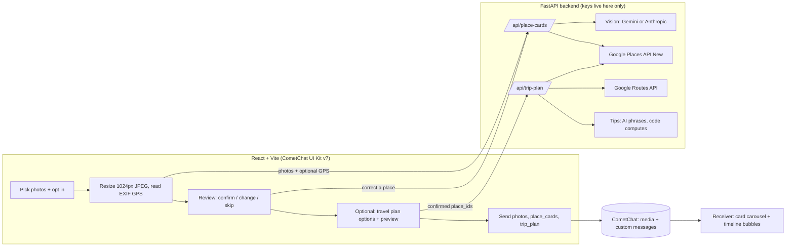

# 📍 Place Cards: opt-in photo-to-place info and travel plans in chat

Built for the CometChat **"Zero to Chat"** build challenge (#ZeroToChat).

Send photos in a CometChat chat as usual. If you **opt in**, the app identifies the place in each photo,
shows you what it found, **you confirm or correct it**, and the receiver gets the photos plus compact
**place cards** (rating, price, open-now, short summary, reviews, nearby restaurants, Open in Maps).
Optionally add a **travel plan**: the best stop order, traffic-aware legs, lunch, traffic windows to avoid,
and a cheapest vs comfort cost estimate, delivered as one stop-by-stop timeline.

> Demo video: _add link_ · Live app: _add link_ · Challenge thread: https://x.com/CometChat/status/2103065271233888471

**Why it is interesting:** AI enrichment that is *opt-in*, honest about uncertainty (a human confirms every
guess), privacy-safe (the sender's GPS never leaves the lookup), and numeric facts come from APIs, never from the model.

## How it works



Photos go as normal CometChat media messages. The place info is ONE custom message `place_cards`; the plan is ONE
custom message `trip_plan`. Both render through UI Kit v7 message plugins, for sender and receiver alike.

## Quick start (mock mode, no keys except CometChat)

```bash
# backend
cd backend && python3 -m venv .venv && source .venv/bin/activate
pip install -r requirements.txt && cp .env.example .env && pytest
uvicorn app.main:app --reload            # http://127.0.0.1:8000

# frontend (second terminal)
cd frontend && cp .env.example .env      # fill the 3 VITE_COMETCHAT_* values from app.cometchat.com
npm install && npm run dev               # http://localhost:5173
```

Open two tabs, log in as `user1` and `user2` (login is per tab). The CometChat **Auth Key in client code is for
demos only**; a production app should mint auth tokens on a server.

Mock mode picks its "vision" result by **photo order** (1st = Leopold Cafe, 2nd = Gateway of India, 3rd = ambiguous,
4th = unidentifiable) or `MOCK_SCENARIO`, never by filename or image content. Sample data is not real Google data.

## Environment variables

| Where | Name | Purpose |
|---|---|---|
| frontend | `VITE_COMETCHAT_APP_ID`, `VITE_COMETCHAT_AUTH_KEY`, `VITE_COMETCHAT_REGION` | CometChat credentials (demo auth) |
| frontend | `VITE_API_BASE_URL` | Backend URL (must be `https://` in production) |
| frontend | `VITE_FALLBACK_TEXT_CARDS` | `true` = send place info/plan as plain text if the bubble can't render |
| backend | `MOCK_MODE`, `MOCK_SCENARIO` | Offline fixtures. `MOCK_MODE=false` never falls back to mock |
| backend | `VISION_PROVIDER`, `GEMINI_API_KEY`, `GEMINI_MODEL`, `ANTHROPIC_API_KEY`, `VISION_MODEL` | Vision + tips provider |
| backend | `GOOGLE_PLACES_API_KEY` | Places API (New) and Routes API (same key/project) |
| backend | `ALLOWED_ORIGINS` | Exact frontend origin(s), comma separated |
| backend | `RATE_LIMIT_PER_MINUTE`, `TRUST_PROXY`, `LOG_LEVEL`, `CACHE_TTL_SECONDS` | Hardening / hosting |

Secrets exist only in backend env files or host settings. The frontend never sees a Google, Gemini or Anthropic key.

## Privacy and safety

- **Opt-in only.** Without the toggle, photos send normally and nothing is analysed.
- **No raw GPS in chat.** EXIF GPS is read in the browser, used for the lookup only, and the resized JPEG that is sent
  has all EXIF removed (canvas re-encode). Cards carry no venue coordinates (just `maps_url`); the plan's start is the
  **text you type**, never a location reading. Outgoing messages are whitelisted to the contract fields, so an unexpected
  field (like coordinates) cannot be sent. Tests assert no coordinates in any API response.
- **Private locations.** A GPS point with no public place nearby and nothing identifiable in the photo returns "not found",
  never a street address.
- **Photos are not stored.** Uploads are processed in memory (a test fails if backend code writes files or saves images).
  Request bodies, coordinates, hints and image data are never logged; logs hold counts only (photos, cache hits, Routes calls).
- **Photos do go to the vision provider you choose.** Gemini free-tier terms may allow Google to use inputs to improve
  its products. Use the paid tier or `VISION_PROVIDER=anthropic` if that matters.
- **Untrusted incoming messages.** Any client can send a `place_cards`/`trip_plan` message, so the receiver validates and
  clamps every field, renders text only (never HTML) and only opens http(s) links.

## Reliability and cost control

- Timeouts on every outbound call; one retry on transient Vision, Places and Routes errors (timeouts, 429, 5xx).
- Per-photo failure isolation: if some photos fail the others still return. The sender confirms before anything is sent.
- Per-IP rate limit on `POST /api/*` (default 20/min, `429` with `Retry-After`), request-size limits (64 KB JSON,
  images x 2 MB + overhead for uploads), at most 10 photos per request and 10 stops per plan.
- Tight field masks; place details only for the chosen place, cached 24 h by `place_id`; route matrices cached by
  (origin, destination, mode, hour). Each request logs cache hits/misses; each plan logs its Routes API call count
  (one matrix per departure slot, at most about 8, plus one call per leg per non-drive mode).
- Free-tier Gemini by default; `claude-haiku-5-5` as the cheap Anthropic option. Check Google's **current** Places/Routes
  pricing and free allowance, and set a budget alert on the project.

## Known limitations

- Generic photos (no sign, no landmark, no GPS) cannot be identified: you get candidates or "not found", not a guess.
- No full menus: Google does not reliably provide them; cards show price level and website link.
- Rate limits and caches are in-memory and per process (one small instance). Scaling out needs a shared store.
- Costs are **estimates** from editable placeholder rates in `backend/costs.json` (INR, Mumbai-ish), not real fares or tickets.
- **Traffic windows are modelled** from Routes API traffic-aware vs free-flow times at several departure hours, not
  an official Google "busy hours" feed. Transit/walk/two-wheeler coverage varies; unavailable modes say so.
- One city and one day per plan (auto-split after ~20:00); stops more than ~100 km apart are rejected.
- Version-sensitive API shapes (Places `pageSize`, Routes field masks, Gemini model name, CometChat plugin API) were
  written against the docs at build time; see `PROGRESS.md` for what has and has not been verified live.

## CometChat features and MCP tools used

UI Kit v7 (`CometChatProvider`, conversations, users, message header/list/composer), the composer
`auxiliaryButtonView`, `sendMediaMessage` and `sendCustomMessage`, and two message **plugins** (`place_cards`, `trip_plan`).
The CometChat MCP (`list_cometchat_bundles`, `get_cometchat_implementation_bundle`, `search_cometchat_docs`,
`fetch_cometchat_doc_page`) was used to find the current v7 patterns; the quickstart bundle was stale (v6), so the live v7
docs were followed. No CometChat AI credits are used: AI runs on our own backend.

## Deploy, demo, submission

- Deploy steps: [`DEPLOY.md`](DEPLOY.md) · Demo script and pre-recording checklist: [`DEMO.md`](DEMO.md) · Submission: [`SUBMISSION.md`](SUBMISSION.md)

## Backend reference

### Try it (mock mode)

In mock mode the "vision" step picks a fixture by **photo order in the request** (1st = Leopold Cafe,
2nd = Gateway of India, 3rd = ambiguous "Cafe Madras", 4th = unidentifiable, then it repeats), or by the
`MOCK_SCENARIO` setting (`leopold|gateway|ambiguous|generic`, one name for all photos or a comma list per photo).
**File names and image content are never inspected.**

```bash
curl http://127.0.0.1:8000/api/health

# any small JPEG works; photo 1 -> Leopold Cafe, photo 2 -> Gateway of India (mock order)
curl -X POST http://127.0.0.1:8000/api/place-cards \
  -F "images=@sample.jpg" \
  -F "images=@sample.jpg" \
  -F 'meta=[{"index":0,"hint":"Colaba, Mumbai"}]' \
  -F "global_hint=Mumbai"

# sender corrects / picks a candidate
curl -X POST http://127.0.0.1:8000/api/place-cards/resolve \
  -H "Content-Type: application/json" \
  -d '{"query":"Cafe Leopold","hint":"Mumbai"}'
curl -X POST http://127.0.0.1:8000/api/place-cards/resolve \
  -H "Content-Type: application/json" -d '{"place_id":"mock_madras_matunga"}'
```

Mock fixtures: Leopold Cafe (restaurant), Gateway of India (landmark + nearby restaurants),
three "Cafe Madras" (ambiguous), a private GPS point with no POI (`lat 19.2, lng 72.9` → not found).
Fixture figures/reviews are sample data, not real Google data.

## Live mode

```bash
# backend/.env  (never commit; never paste keys in chat)
MOCK_MODE=false
VISION_PROVIDER=gemini            # or: anthropic
GEMINI_API_KEY=...                # Google AI Studio key (free tier available)
GEMINI_MODEL=gemini-3.5-flash-lite  # check Google's current model list
# ANTHROPIC_API_KEY=... and VISION_MODEL=claude-haiku-5-5   (when VISION_PROVIDER=anthropic)
GOOGLE_PLACES_API_KEY=...         # Places API (New) enabled, key restricted
```

The server refuses to start in live mode if a required key is missing (the error names the variable); it never
silently falls back to mock. Both providers return the same strict-JSON vision result, so the rest of the app is identical.

> **Privacy note:** Gemini free-tier terms may allow Google to use inputs to improve its products. Photos are sent to
> the vision provider you choose; use the paid tier or `VISION_PROVIDER=anthropic` if that matters to you.
> Photos are processed in memory and not stored by this backend.

### Check one real photo (live)

```bash
cd backend
python scripts/live_check.py ../test_photos/IMG_4821.jpg --hint "Mumbai"
python scripts/live_check.py ../test_photos/IMG_4821.jpg --compare   # gemini vs anthropic side by side
```

Prints the vision result, chosen place, status, confidence and source (never coordinates).

## Trip planner API (Phase 5, mock mode works with no keys)

```bash
curl -X POST http://127.0.0.1:8000/api/trip-plan -H "Content-Type: application/json" -d '{
  "place_ids": ["mock_gateway_of_india","mock_csmt","mock_marine_drive","mock_haji_ali","mock_siddhivinayak"],
  "photo_indexes_by_place": {"mock_csmt": [0, 2]},
  "start_time": "09:30",
  "start": {"place_id": "mock_leopold_cafe"},
  "travelers": 2,
  "objective": "least_time",
  "variants": ["cheapest", "comfort"],
  "entry_fees": {"mock_csmt": 100}
}'
```

Returns `{plans: [TripPlan...], status: ok|partial|unsupported, warnings}` (PROJECT_PLAN 4.7/4.8). In mock mode the
`place_id`s are the sample ones in `fixtures/places_*.json`; in live mode use the `place_id`s from place cards.

**How a plan is made:** order = best permutation (≤ 8 stops) or nearest-neighbour + 2-opt (9–10) over Routes API
traffic-aware drive times (or distances); timeline = arrive/depart per stop; lunch near 13:00 at an open, rating-ranked
restaurant within 500 m (cheapest: price level ≤ 2, comfort: ≥ 2 when available); a day split after ~20:00;
opening-hours warnings (stops are never silently reordered); `cheapest` uses walk/transit when within 1.8× of driving time,
otherwise an auto/budget cab rate; `comfort` is cab for every leg.

**Honest limits:** every distance, time, hour and price comes from the APIs or from the editable assumptions in
`backend/costs.json` (placeholder INR rates, not real fares); the AI only phrases ≤ 4 tips and its output is discarded
if it uses a number that is not in the plan. Costs are labelled estimates. **Traffic windows are modelled** from
Routes API drive times at several departure hours (ratio of traffic-aware to free-flow time), **not** an official Google
"busy hours" feed. Transit/walk/two-wheeler availability varies by region; unavailable modes are reported as "Not
available", never guessed. Stops more than ~100 km apart → `status: unsupported`. Return leg (`return_to_start`) is
included in the end time and cost but not shown as a stop.

## How resolution works (per photo)

1. **GPS** (client EXIF or server Pillow fallback): Places Nearby (75 m) + vision in parallel. Vision name fuzzy-matches a nearby place → `ok`/high. No vision name: accept the nearest POI only if it is the single one within 30 m (`medium`), else `low_confidence` with candidates.
2. **No GPS, vision reads signage/landmark**: Text Search `"<name> <hint or area>"`; accepted only if the top result fuzzy-matches (≥ 70) and isn't ambiguous.
3. **Otherwise** `not_found` — the UI asks the sender to type a place or skip.
4. **Privacy**: a GPS point with no public POI and nothing identifiable in the photo returns `not_found`, never an address. Sender coordinates are used only for lookups and never appear in responses or logs. Cards contain no venue coordinates either (just `maps_url`).

Place details (reviews, hours, rating) are fetched only for the chosen place and cached 24 h by `place_id`. Photos of the same place are merged into one card.

### Tests

`cd backend && pytest` (135 tests, mock mode) · `cd frontend && npm test` (25 tests) · `npm run lint` · `npm run build`.
Smoke-test a deployed backend with real photos: `python backend/scripts/smoke_test.py <url> --origin <frontend-origin> --photo ... --plan`.

## Fallback

If the card bubble fails to render in your setup, set `VITE_FALLBACK_TEXT_CARDS=true` to send place info and the plan as one formatted text message each.
